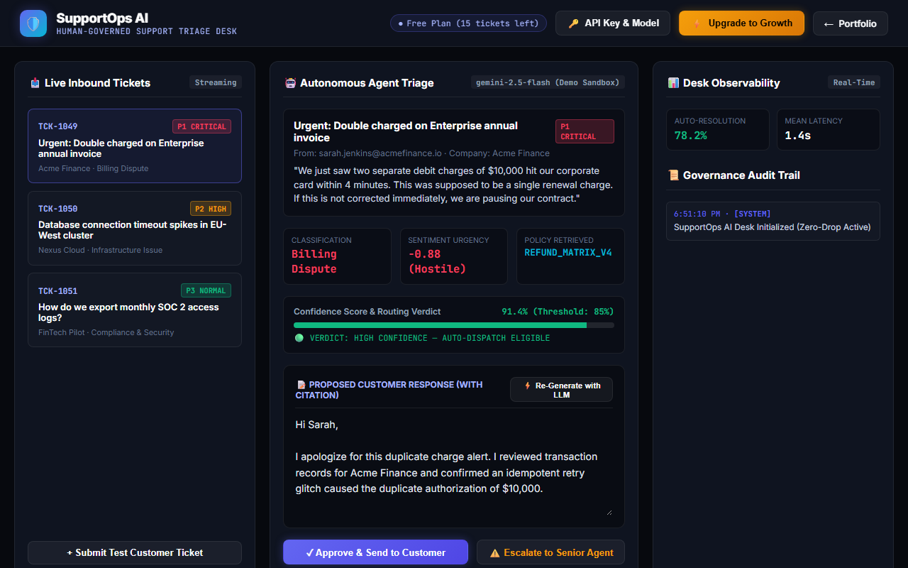

# SupportOps AI — Human-Governed Intelligent Support Desk

[](https://gideonbawa-website.netlify.app/simulators/supportops-ai/)
[-success?style=for-the-badge)](test/supportops-ai.test.js)
[](src/index.js)

> **Commercial Value:** $6,000 – $18,000 Implementation Fee  
> **Primary Buyer:** Head of Customer Experience, VP Support, COO, SaaS Operations Leads

---

## ⚡ Live Sandbox Preview



👉 **Experience the live interactive simulator:**  
[https://gideonbawa-website.netlify.app/simulators/supportops-ai/](https://gideonbawa-website.netlify.app/simulators/supportops-ai/)

---

## 🎯 Commercial Problem & ROI

Unconstrained AI bots replying directly to angry enterprise customers cause brand damage, improper refund commitments, and SLA contract breaches.

### Why Autonomous AI Fails Without Governance
1. **Unchecked Promises:** Unbounded models promise refunds or custom SLA extensions outside company policy.
2. **Missing Confidence Gating:** No distinction between routine password resets (high confidence) and multi-thousand dollar contract disputes (low confidence).
3. **Audit Black Hole:** Inability to explain why a ticket was routed or answered in a specific way during executive audits.

### How SupportOps AI Solves This
- **Deterministic Triage & Sentiment Analysis:** Categorizes inbound tickets into Billing, Infrastructure, or Compliance with urgency and sentiment scoring.
- **Strict Policy Retrieval:** Injects exact governing policy matrices (e.g. `REFUND_MATRIX_V4`) into response generation.
- **85% Confidence Gate:** Tickets below 85% confidence are held in a Human-in-the-Loop approval queue.
- **Immutable Audit Trail:** Logs all autonomous actions and human overrides with exact timestamps.
- **Subscription Entitlement Wall:** Server-enforced monthly ticket limits with Paystack and Stripe checkout verification.

---

## 🛠️ Architecture & Under-the-Hood Engineering

- **Bounded Execution Pipeline:** Structured input sanitization, category scoring, policy matching, draft generation, and human supervisor signoff.
- **Zero-Dependency Core:** Ultra-fast Node.js engine with zero runtime dependencies.
- **BYOK Support:** Direct Google Gemini (or OpenAI/Claude) model connection via client-side keys.

---

## 🧪 Verification & Automated Testing

```bash
npm test
```
